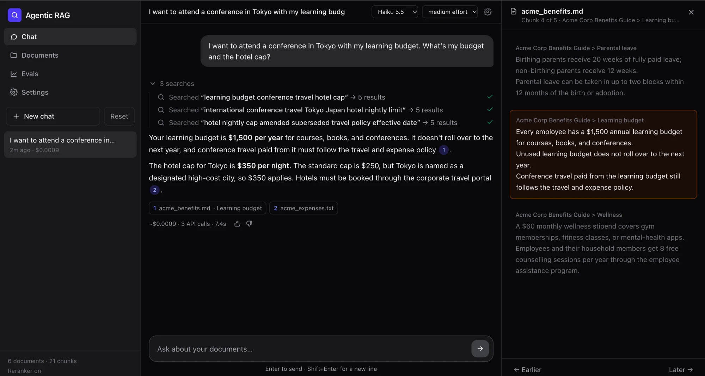

# Agentic RAG with Claude

A retrieval-augmented generation system in which **Claude drives retrieval itself**: it decides
what to search, splits compound questions into several searches, reformulates queries that miss,
reads surrounding chunks for context, and answers with inline citations like `[policy.md#2]`.

## How it works

```
question ─► Claude (claude-sonnet-5-5) ──tool calls──► list_documents
               ▲                                       search_knowledge_base
               │                                         BM25 + vectors ─► RRF fusion ─► cross-encoder rerank
               └──────────── tool results ◄─────────── read_chunks (neighbouring context)
            ... loops until it has enough evidence ...
            ─► cited answer  (+ token usage and cost)
```

| File | Role |
|---|---|
| `rag/store.py` | Loads `.md` / `.txt` / `.pdf`; heading-aware chunking (each chunk knows its Markdown section path); incremental indexing into ChromaDB (local all-MiniLM-L6-v2 ONNX embeddings) + BM25; hybrid search with Reciprocal Rank Fusion; optional local cross-encoder reranking |
| `rag/agent.py` | The agent loop: strict tool schemas, parallel tool execution, multi-turn memory, step limit, refusal / `max_tokens` handling, event callbacks, per-question cost tracking |
| `rag/evaluate.py` | Retrieval metrics, and answer grading that compares the agent with the one-shot baseline per question category |
| `rag/baseline.py` | One-shot RAG baseline (retrieve once, answer once) for comparison |
| `evals/basic`, `evals/hard` | Eval sets: questions with evidence snippets, expected sources and reference answers, plus the hard set's own documents |
| `main.py` | CLI |
| `server/app.py` | FastAPI backend for the web UI: streaming chat over Server-Sent Events, conversations, chunk lookup for citations |
| `frontend/` | React + Vite + Tailwind chat UI |
| `rag/fake_llm.py` | Stand-in Claude client for tests and for running the UI with no API key (demo mode) |
| `tests/` | pytest suite (no API key needed) |

## Setup

```bash
python3 -m venv .venv && source .venv/bin/activate
pip install -r requirements.txt
export ANTHROPIC_API_KEY=sk-ant-...
```

The first run downloads two small local models once: the embedding model (~80 MB) and the
reranker (`Xenova/ms-marco-MiniLM-L-6-v2`, from Hugging Face). If the reranker can't be
downloaded, search keeps working without it (or pass `--no-rerank`).

## Usage

```bash
python main.py ingest docs                 # sync the index; only new/changed files are re-embedded
python main.py ingest docs --rebuild       # re-embed everything
python main.py search "carry over"         # test retrieval alone, no API call (--mode bm25|vector|hybrid)
python main.py ask "How many vacation days do I get after 6 years, and how many can I carry over?"
python main.py chat                        # multi-turn; /reset, /cost, /quit
```

`ask` / `chat` take `--model` (`claude-sonnet-5-5` default, `claude-opus-5-5`, `claude-haiku-5-5`),
`--effort` (`low` … `max`, default `medium`) and `-q` to hide the tool trace and cost line.

## Web UI



Streaming answers, a live trace of the agent's searches, numbered citation chips that open the
cited chunk (with its neighbours) in a side panel, per-answer cost, model/effort pickers, and a
conversation list. Works on mobile and in dark mode.

```bash
cd frontend && npm install && npm run build && cd ..   # once, and after frontend changes
python -m uvicorn server.app:app --port 8000           # then open http://localhost:8000
```

- **Demo mode:** `RAG_FAKE_LLM=1 python -m uvicorn server.app:app` runs the whole UI with real search but a
  fake model: no API key, no cost. Handy for UI work.
- **Frontend dev with hot reload:** run the server as above, then `cd frontend && npm run dev` and open
  http://localhost:5173 (API calls are proxied to :8000).
- Other settings: `RAG_INDEX` (index directory), `RAG_RERANK=0` (turn off the reranker).
- Conversations are kept in memory for now and are lost when the server restarts.

## Evaluation

Two eval sets ship with the repo, each a folder with `questions.jsonl`, `config.json` and its own documents:

| Set | What it tests |
|---|---|
| `evals/basic` (20 questions) | Single-fact lookups over the sample Acme docs. A smoke test - everything should score ~100%. |
| `evals/hard` (40 questions) | A fictional company (Halcyon Robotics, 19 docs) built so that **one search with the question text is not enough**: multi-step lookups (person → manager → office → cost tier → hotel cap), policies that were superseded, amended or overridden by a decision log, country exceptions, lists spread across sections, false premises, unanswerable questions, and simple control questions. |

```bash
python main.py eval --set evals/hard                         # retrieval metrics only - free
python main.py eval --set evals/hard --answers --systems agentic,naive --model claude-haiku-5-5
python main.py eval --set evals/hard --answers --systems agentic,naive              # Sonnet
python main.py eval --set evals/hard --answers --systems naive --naive-k 15        # more context, still one shot
```

`--systems agentic,naive` compares the agent with a **one-shot RAG baseline** (`rag/baseline.py`):
retrieve the top-k chunks for the question, answer in a single call. Both use the same retriever,
reranker, model, effort and answering rules, so the difference is the agent loop itself. The report
breaks accuracy down by question category and shows **evidence retrieved** - how much of the text
needed to answer each question the system actually saw.

Answers are graded by a `claude-haiku-5-5` judge against reference answers (`--judge-model` to change),
and results are saved to `evals/results/`. Other flags: `--category multi_hop`, `--limit N`, `--workers N`.

Rough cost for the hard set (estimates): Haiku, both systems ≈ $0.15; Sonnet, both systems ≈ $1-2.

## Tests

```bash
pip install -r requirements-dev.txt && pytest -q   # 18 tests, no API key needed
```

## Settings worth knowing

- **Model** – `MODEL` in `rag/agent.py` or `--model`. Sonnet 5.5 is ~$0.02–0.05 per typical question; Opus 5.5 is 2× that, Haiku 5.5 ~1/20.
- **Effort** – `medium` by default; `high` helps on hard multi-hop questions.
- **Refusal fallback** – requests use `fallbacks="default"` (beta `server-side-fallback-2026-07-01`): if a safety classifier declines, the API reruns the request on a fallback model. Remove those two arguments in `rag/agent.py` to turn it off.
- **Prompt caching** – the conversation prefix is cached automatically, so the agent's repeated calls within a question cost less once the prompt is long enough to be cached.
- **Step limit** – `max_steps=12` model calls per question; after that it is told to answer with what it has.
